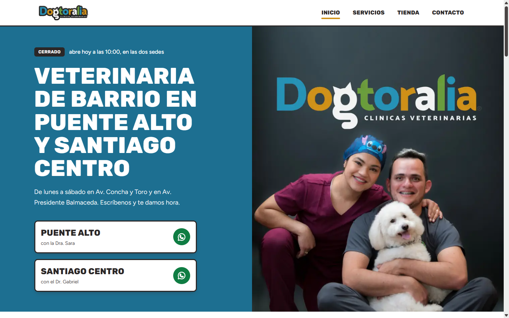
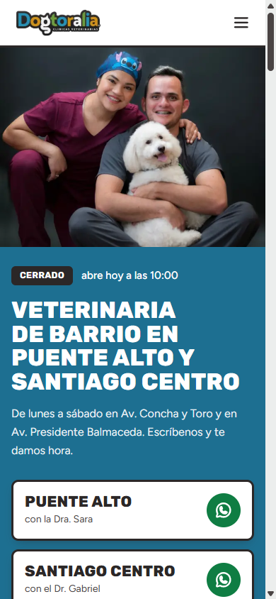

# Dogtoralia Vet 🐾

**Sitio web de una clínica veterinaria de barrio con dos sedes en Santiago de Chile: servicios, tienda vitrina y contacto, pensado para que agendar por WhatsApp sea a un toque.**


🌐 **Sitio en producción:** [dogtoraliavet.cl](https://dogtoraliavet.cl)

<table>
  <tr>
    <th>Escritorio</th>
    <th>Móvil</th>
  </tr>
  <tr>
    <td></td>
    <td></td>
  </tr>
</table>

---

## Índice

- [¿Qué problema resuelve?](#qué-problema-resuelve)
- [Características](#características)
- [Tecnologías](#tecnologías)
- [Requisitos previos](#requisitos-previos)
- [Instalación paso a paso](#instalación-paso-a-paso)
- [Uso](#uso)
- [Estructura del proyecto](#estructura-del-proyecto)
- [Configuración (.env)](#configuración-env)
- [Despliegue](#despliegue)
- [Roadmap](#roadmap)
- [Cómo contribuir](#cómo-contribuir)
- [Licencia](#licencia)
- [Autor](#autor)

---

## ¿Qué problema resuelve?

Las familias que buscan veterinaria entran casi siempre desde el celular y quieren una sola cosa: **conseguir hora rápido**. Dogtoralia tiene dos sedes (Puente Alto y Santiago Centro), cada una con su propio WhatsApp, y no tiene sistema de reservas online.

Este sitio lleva a la persona de "necesito llevar a mi mascota" a **un WhatsApp enviado a la sede correcta**, mostrándole antes lo que necesita para confiar: servicios, horarios, si la clínica está abierta ahora, cómo llegar, el equipo y reseñas reales de Google. La tienda funciona como **vitrina**: no hay carrito ni pago online; cada producto se consulta por WhatsApp y se retira en la sede.

## Características

**Para quien visita el sitio**

- 🟢 **WhatsApp primero**: botones de "pedir hora" y consulta que abren WhatsApp con un mensaje prellenado, con la sede elegida.
- 🕒 **Letrero "abierto / cierra pronto / cerrado"** calculado con la hora de Chile (`America/Santiago`), no con la del navegador.
- 🏥 **Servicios**: Consultas, Vacunas, Exámenes, Procedimientos y Peluquería canina y felina (corte y baño, baño medicado).
- 🛍️ **Tienda vitrina** con 108 productos (medicamentos y shampoos): búsqueda instantánea sin distinguir acentos, filtro por categoría, paginación con "Ver más" y etiqueta para productos que requieren receta.
- 📄 **Ficha de cada producto** con su propia URL (`/product/[id]`), generada de forma estática al compilar.
- ✉️ **Formulario de contacto** que envía el mensaje por correo (Resend) a la sede elegida, con "Responder" dirigido a quien escribió.
- 📍 **Sedes** con dirección, teléfono y enlaces a Google Maps y Waze.
- ⭐ **Reseñas reales de Google** y presentación del equipo.
- ⚖️ Páginas de **Términos** y **Privacidad**, y página 404 propia.

**Por dentro**

- 🔒 **Seguridad**: validación con zod en el servidor, escape de HTML en el correo, rate limiting por IP con Upstash Redis (5 mensajes cada 10 min en `/api/contact`, 60 por minuto en `/api/products`) y cabeceras de seguridad (CSP, HSTS, X-Frame-Options, etc.). Si falta Redis en producción, la API responde 503 en vez de quedar sin protección.
- 🔎 **SEO**: metadata por página, URL canónica, datos estructurados JSON-LD (`Organization`, `WebSite`, `VeterinaryCare` por sede, `Service`, `BreadcrumbList`), y `sitemap.xml`, `robots.txt` y `manifest.webmanifest` generados automáticamente.
- 🗂️ **Catálogo con esquema único** (zod): si un producto está mal escrito, el build falla con el detalle. El acceso pasa por una interfaz (`CatalogRepository`), así que cambiar el JSON por una base de datos no obliga a tocar las páginas.
- 📊 Analítica de comportamiento con Microsoft Clarity.

## Tecnologías

| Área | Herramienta |
| --- | --- |
| Framework | [Next.js 16](https://nextjs.org/) (App Router, Turbopack) |
| UI | [React 19](https://react.dev/), [Tailwind CSS 4](https://tailwindcss.com/), [Framer Motion](https://motion.dev/), [React Icons](https://react-icons.github.io/react-icons/) |
| Lenguaje | TypeScript 5 |
| Validación | [zod 4](https://zod.dev/) |
| Correo | [Resend](https://resend.com/) |
| Rate limiting | [Upstash Redis](https://upstash.com/) + `@upstash/ratelimit` |
| Calidad | ESLint 9 (`eslint-config-next`) |
| Fuentes | Rubik y Figtree vía `next/font` |
| Hosting | Vercel |

## Requisitos previos

Antes de empezar, instala:

1. **[Node.js](https://nodejs.org/) 22.18 o superior** (incluye `npm`). Next.js 16 funciona desde Node 20.9, pero el script `npm run catalog:check` necesita 22.18+. Para revisar tu versión:

   ```bash
   node -v
   ```

2. **[Git](https://git-scm.com/)** para clonar el repositorio.

Opcional (solo si quieres que funcionen todas las piezas en tu computador):

- Una cuenta en **Resend** con una API key, para que el formulario de contacto envíe correos de verdad.
- Una base **Upstash Redis** (el plan gratis alcanza). En desarrollo no hace falta: se usa un contador en memoria.

## Instalación paso a paso

**1. Clona el repositorio y entra a la carpeta**

```bash
git clone https://github.com/diegocabre/dogtoralia.git
```

```bash
cd dogtoralia
```

**2. Instala las dependencias**

```bash
npm install
```

**3. Crea tu archivo de variables de entorno** copiando la plantilla:

```bash
cp .env.example .env
```

En Windows con PowerShell puedes usar `Copy-Item .env.example .env`. Abre `.env` y completa los valores (ver [Configuración](#configuración-env)). Para solo mirar el sitio puedes dejarlo tal cual: todo funciona salvo el envío del formulario de contacto.

**4. Levanta el servidor de desarrollo**

```bash
npm run dev
```

**5. Abre el sitio** en [http://localhost:3000](http://localhost:3000). La raíz `/` redirige a `/home`, que es la página de inicio.

## Uso

### Scripts disponibles

| Comando | Qué hace |
| --- | --- |
| `npm run dev` | Servidor de desarrollo con recarga automática en `localhost:3000`. |
| `npm run build` | Compila el sitio para producción (valida el catálogo y genera las fichas de producto). |
| `npm run start` | Sirve la versión compilada. Ejecuta antes `npm run build`. |
| `npm run lint` | Revisa el código de `src/` con ESLint. |
| `npm run catalog:check` | Valida `src/data/products.json` y que existan las imágenes locales. |

### Páginas

| Ruta | Contenido |
| --- | --- |
| `/home` | Inicio: portada, servicios, equipo, reseñas, sedes y WhatsApp. |
| `/service` | Detalle de servicios y botón para pedir hora. |
| `/store` | Tienda vitrina con búsqueda y filtro. |
| `/product/[id]` | Ficha de un producto (el `id` es su código de barras). |
| `/contact` | Formulario de contacto y datos de cada sede. |
| `/terminos`, `/privacidad` | Páginas legales. |

### Ejemplo: agregar o editar un producto

Los productos viven en `src/data/products.json`. Cada uno se ve así:

```json
{
  "id": 7804650310129,
  "name": "Revolution Plus (5 a 10 kg)",
  "category": "Medicamento",
  "subCategory": "Antiparasitario",
  "price": 16798,
  "iva": 19,
  "requiresPrescription": true,
  "stock": 3,
  "imageUrl": "/images/products/catalogo/revolution-plus-gato-5-10kg.jpg",
  "description": "Texto opcional que aparece en la ficha."
}
```

Reglas que revisa el esquema (`src/lib/catalog/schema.ts`):

- `id`: código de barras de 8 a 14 dígitos, sin repetir.
- `category`: `"Medicamento"` o `"Shampoos"`.
- `price`: entero en pesos chilenos (CLP), con IVA incluido.
- `imageUrl`: ruta local dentro de `public/` (por ejemplo `/images/products/...`) o URL `https`, terminada en `.jpg`, `.png`, `.webp` o `.avif`.

Después de editar, comprueba que todo esté bien:

```bash
npm run catalog:check
```

Si hay errores, el script los lista todos con la posición del producto y sale con código 1.

### Ejemplo: cambiar datos del negocio

Cada dato vive en un solo archivo y desde ahí se actualizan la página, el footer y los datos para Google:

| Quiero cambiar… | Archivo |
| --- | --- |
| Dirección, teléfono, WhatsApp o correo de una sede | `src/data/locations.ts` |
| Horario, palabras clave SEO, redes sociales | `src/data/site.ts` |
| Textos de los servicios | `src/data/services.ts` |
| Equipo | `src/data/team.ts` |
| Reseñas | `src/data/reviews.ts` |

### Ejemplo: consultar la API de productos

```bash
curl http://localhost:3000/api/products
```

Devuelve el catálogo completo en JSON. Si superas 60 solicitudes por minuto desde la misma IP, responde `429` con la cabecera `Retry-After`.

## Estructura del proyecto

```text
dogtoralia/
├── public/
│   ├── images/              # Portada, fachadas de las sedes, imagen para compartir y fotos de productos
│   ├── img/LOGO.png         # Logo oficial
│   └── icons/
├── scripts/
│   └── catalog-check.mjs    # Validación del catálogo (npm run catalog:check)
├── src/
│   ├── app/                 # Páginas y rutas (App Router)
│   │   ├── api/
│   │   │   ├── contact/     # POST: envía el formulario por correo
│   │   │   └── products/    # GET: catálogo en JSON
│   │   ├── home/  service/  store/  product/[id]/  contact/
│   │   ├── terminos/  privacidad/  not-found.tsx
│   │   ├── layout.tsx       # Fuentes, metadata global, Clarity
│   │   └── sitemap.ts  robots.ts  manifest.ts
│   ├── components/          # UI por sección: home, store, contact, appointments, navbar, footer, seo...
│   ├── data/                # Contenido del negocio (sedes, servicios, equipo, reseñas, productos)
│   ├── lib/
│   │   ├── catalog/         # Esquema, repositorio y búsqueda del catálogo
│   │   ├── security/        # Validación (zod) y rate limiting
│   │   ├── hours.ts         # Cálculo de "abierto ahora" en hora de Chile
│   │   ├── mail.ts          # Envío de correo con Resend
│   │   └── seo.ts           # Metadata y JSON-LD
│   └── types/
├── .env.example             # Plantilla de variables de entorno
├── next.config.ts           # Redirect / → /home y cabeceras de seguridad
├── DESIGN.md  PRODUCT.md    # Sistema de diseño y contexto del negocio
└── SEGURIDAD.md             # Estado de seguridad y pendientes
```

## Configuración (.env)

Copia `.env.example` como `.env` y completa los valores. **Nunca subas `.env` a git** (ya está en `.gitignore`).

| Variable | ¿Obligatoria? | Para qué sirve |
| --- | --- | --- |
| `NEXT_PUBLIC_SITE_URL` | No | URL pública sin `/` final. La usan el sitemap, robots, URLs canónicas y JSON-LD. Por defecto: `https://dogtoraliavet.cl`. |
| `RESEND_API_KEY` | Para el formulario | Clave de Resend (resend.com → API Keys). Sin ella, el formulario muestra error al enviar. |
| `CONTACT_FROM_EMAIL` | No | Remitente de los correos; debe ser de un dominio verificado en Resend. Por defecto: `Dogtoralia <notificaciones@dogtoraliavet.cl>`. |
| `UPSTASH_REDIS_REST_URL` | En producción | URL REST de tu base Upstash Redis. |
| `UPSTASH_REDIS_REST_TOKEN` | En producción | Token REST de Upstash. |
| `KV_REST_API_URL` / `KV_REST_API_TOKEN` | Alternativa | Los crea la integración de Upstash en Vercel; reemplazan a las dos anteriores. |
| `RATE_LIMIT_MEMORY_FALLBACK` | No | Ponla en `1` solo para probar `npm run build && npm run start` en tu computador sin Upstash. Se ignora en Vercel. |

Cómo se comporta el rate limiting según el entorno:

- **`npm run dev`** sin Upstash → usa un contador en memoria y avisa por consola. Todo funciona.
- **Producción** sin Upstash → `/api/contact` y `/api/products` responden `503` (falla cerrada a propósito).

## Despliegue

El proyecto está preparado para **Vercel**:

1. Importa el repositorio en Vercel.
2. En *Settings → Environment Variables* agrega `RESEND_API_KEY`, `CONTACT_FROM_EMAIL` y `NEXT_PUBLIC_SITE_URL`.
3. Conecta Upstash desde *Storage / Integrations* (crea `KV_REST_API_URL` y `KV_REST_API_TOKEN`) o agrega a mano las variables `UPSTASH_REDIS_REST_*`.
4. Despliega. `next.config.ts` desactiva la caché persistente de Turbopack en el build para que el CSS publicado nunca quede desfasado del código.

## Roadmap

Lo que sigue, según la documentación interna del proyecto:

- [ ] **Reserva de horas online**: hoy se agenda por WhatsApp. Las alternativas evaluadas están en [`RESERVAS-PROPUESTA.md`](RESERVAS-PROPUESTA.md).
- [ ] **Atención a domicilio** como servicio visible en el sitio (hoy existe en la práctica, pero no aparece).
- [ ] **Endurecer la Content-Security-Policy** con nonces para quitar `unsafe-inline` y `unsafe-eval` (ver [`SEGURIDAD.md`](SEGURIDAD.md)).
- [ ] **Fotos propias** para los productos que aún no tienen imagen.
- [ ] **Catálogo fuera del JSON** (base de datos o CMS): la interfaz `CatalogRepository` ya está lista para eso.
- [ ] Pruebas automatizadas (el proyecto aún no tiene).

## Cómo contribuir

El código es de todos los derechos reservados (ver [Licencia](#licencia)), así que las contribuciones son solo por invitación del autor. Si te invitan a colaborar:

1. Haz un *fork* del repositorio y crea una rama descriptiva:

   ```bash
   git checkout -b mejora/filtro-por-subcategoria
   ```

2. Haz tus cambios y, antes de enviarlos, verifica que todo pase:

   ```bash
   npm run lint
   ```

   ```bash
   npm run catalog:check
   ```

   ```bash
   npm run build
   ```

3. Haz *commit* con un mensaje claro en español (por ejemplo: `Agrega filtro por subcategoría en la tienda`).
4. Abre un *Pull Request* explicando qué cambiaste y por qué, con capturas si toca la interfaz.

Algunas reglas del proyecto (detalle en [`PRODUCT.md`](PRODUCT.md) y [`DESIGN.md`](DESIGN.md)):

- **No inventes datos del negocio**: precios de servicios, años de trayectoria, certificaciones o testimonios que no sean las reseñas reales de Google.
- **No reemplaces los activos protegidos**: el logo, la foto del equipo y las fachadas de las sedes.
- **No rompas las URLs ni el SEO**: `/home` es la URL canónica del inicio.
- Textos en español de Chile, tuteando, con tono cercano.

Si encuentras un problema de seguridad, no abras un *issue* público: contacta al autor de forma privada a través de [su perfil de GitHub](https://github.com/diegocabre).

## Licencia

© 2026 Diego Cabré. **Todos los derechos reservados.**

El código se publica solo para consulta. No se permite copiarlo, modificarlo, distribuirlo ni usarlo, total o parcialmente, sin autorización escrita del autor. Lo mismo aplica a la marca Dogtoralia, el logo, las fotografías del equipo y de las sedes, y al resto del contenido del sitio. Ver [`LICENSE`](LICENSE).

## Autor

**Diego Cabré** — [@diegocabre](https://github.com/diegocabre)

Clínicas: **Dogtoralia Vet** · [Facebook](https://www.facebook.com/dogtoraliavet/) · [Instagram](https://www.instagram.com/dogtoraliavet/)
